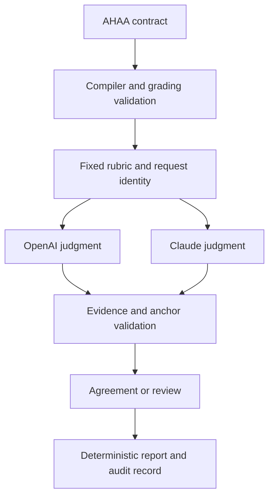

# Architecture

## Two layers of constraints

The Rust implementation uses the real compiler from [RelSpec, now named AHAA](https://github.com/kimyubin33/relspec-lang). The upstream source is pinned at `de1e956555dcfafc5b62324ea6ed3f62655c6ba3`. Its parser and checker produce checked scene records. Percent Grading then applies an additional grading-specific semantic contract.

AHAA checks the language structure. Percent Grading checks whether that structure defines a usable rubric: recognized record kinds, required fields, valid references, fixed criterion dimensions, positive weights, permitted anchors, and supported provider identities. Passing the language checker alone does not establish that a rubric is complete, fair, or scientifically correct.

The native AHAA keywords remain Korean because they are part of the user's language. Example identifiers, descriptions, output, and technical documentation are English. The integration does not silently replace AHAA with a similar-looking custom parser.

## Authority and data flow

The rubric author defines what is evaluated and how much each accepted anchor earns. The two models classify evidence using those anchors. Rust owns the point mapping, weights, bounds, and reporting rules. Models cannot introduce a new criterion, invent an anchor, change its points, or submit their own numerical grade.

The supported live providers are exactly OpenAI and Anthropic Claude. The program calls their official APIs directly. A ChatGPT web subscription is not an API credential. Provider model IDs are explicit configuration because API availability varies by account and over time.

## Agreement does not mean forced agreement

For each criterion, both judges must identify the same supported anchor before it becomes an accepted criterion result. A different anchor or unresolved judgment remains visible as disagreement. The program preserves a bounded result for inspection and withholds the affected final decision. It does not average two conflicting interpretations into an apparently settled grade.

There are three different guarantees:

| Layer | Guarantee | Limit |
|---|---|---|
| Input contract | Only supported structures and values reach aggregation | A well-formed statement can still be false |
| Numerical scoring | The same validated judgments and rubric produce the same arithmetic | An AI may classify an answer differently on a fresh call |
| Recorded replay | A valid saved run can be reused without asking the models to judge again | Replay preserves an earlier judgment; it does not prove that judgment correct |

Model agreement is evidence about agreement, not an independent probability of truth. Both systems may share a misconception. Exact quotation checks establish that a substring exists in the answer; they do not establish that it entails the chosen anchor.

## Present fulfillment and future exploration

The current-task profile distinguishes intent, principle, reasoning, and conditions. Future-oriented criteria describe explicit alternatives, hypotheses, proposed experiments, or possible developments. Future exploration is reported separately from current-task fulfillment so that a speculative possibility cannot repair a false claim about the present specimen.

Every future claim should name what would need to change and what evidence could test it. A scenario can earn credit for being clearly specified while remaining unverified. A rubric percentage is not the probability that the scenario will occur.

## Perspectives do not create extra votes

A perspective is a declared way to inspect a criterion. Relevant lenses can include perception, surface reflectance, causal reasoning, or experimental design. Their sources and assumptions belong in the contract and audit trail. The same answer is still evaluated against the fixed criteria.

Adding ten descriptions of the same physical mechanism does not create ten new shares of the grade. Version 0.3 selects bounded context from a sourced catalog using answer-independent keyword matching. It suppresses declared overlap groups and exact duplicate content, reports omitted records and coverage gaps, and freezes the selection into the run identity. The selector supports catalogs of up to 10,000 entries; this capacity is not evidence that 10,000 real theories have been curated or validated.

The discovery adapter queries Crossref for bibliographic candidates. It never promotes a title or DOI into a verified scientific claim. A curator must inspect the underlying source before creating a catalog entry. Only selected catalog context reaches the two AI judges; the full catalog remains in the local audit snapshot. See the [research guide](RESEARCH_GUIDE.md) for the workflow and limits.

## Trust boundaries

Questions, answers, quotations, and source descriptions are data. They must not become operational instructions to change the contract. Model output is untrusted until the JSON shape, criterion set, anchor IDs, and required evidence have been checked. Invalid or incomplete responses fail closed rather than becoming a guessed grade.

Credentials are read from provider-specific environment variables. They are not placed in model prompts or audit files. Network requests use fixed provider endpoints, response-size limits, timeouts, output-token limits, and bounded retry attempts. These are operational bounds, not a promise of a particular monetary price.

Saved reports may contain the original question and answer, quotations, and provider responses. Keep private learner data out of public repositories. The default local run directory is ignored by Git.

## Version boundaries

The Python 0.1.1 implementation remains available as a historical prototype. It accepts manually supplied numerical judgments under its own JSON protocol. Rust 0.2.0 introduced the stricter anchor protocol and two-provider workflow. Rust 0.3.0 adds optional research context while preserving the scoring rules. It can replay 0.2 records without changing their original identities or reports. Neither Rust protocol silently accepts Python judgment files.

See [the Rust guide](RUST_GUIDE.md) for the executable contract, commands, and current file formats.
